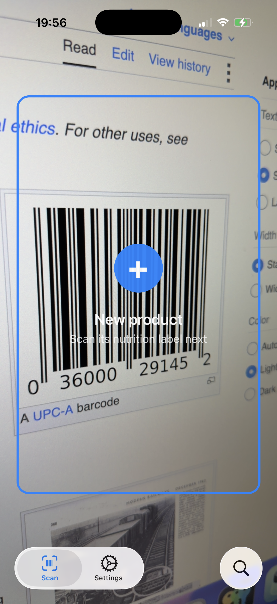
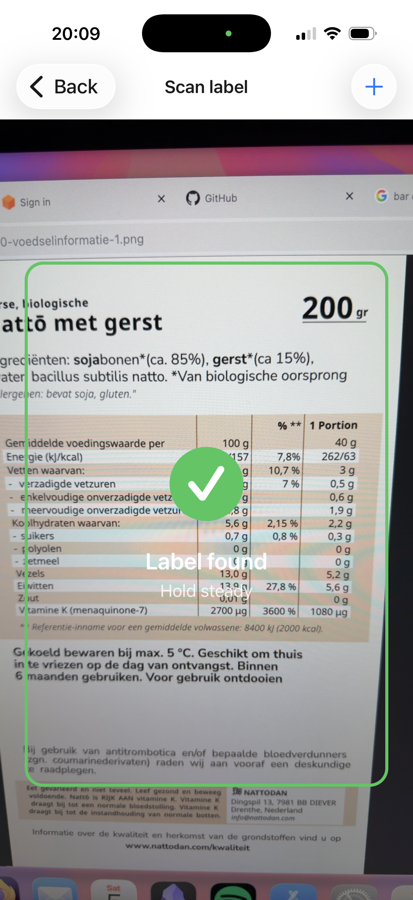
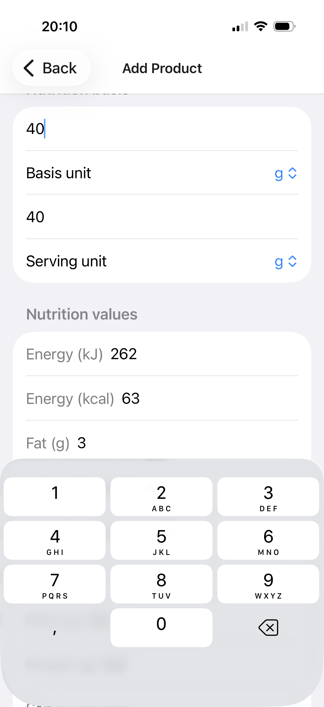
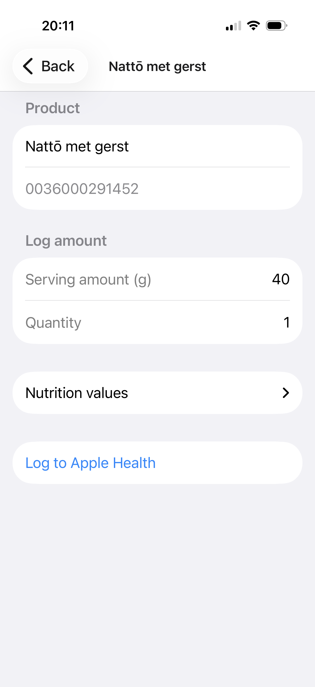
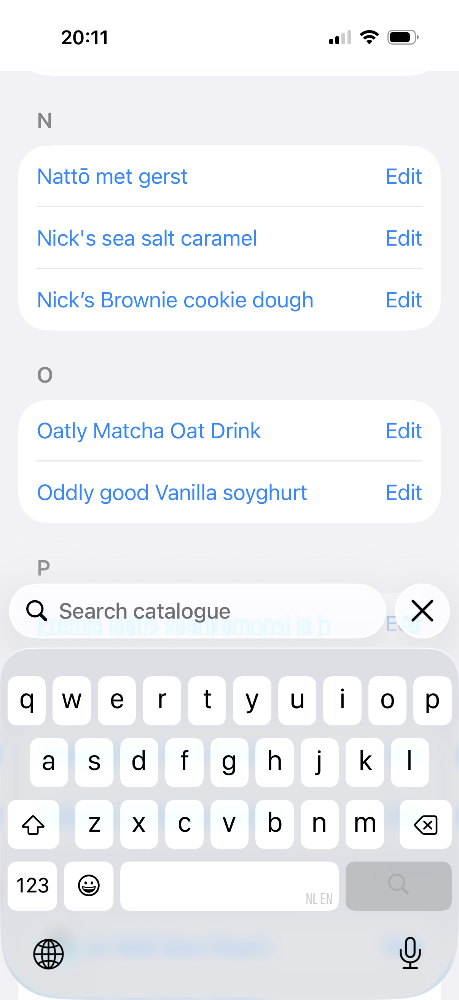
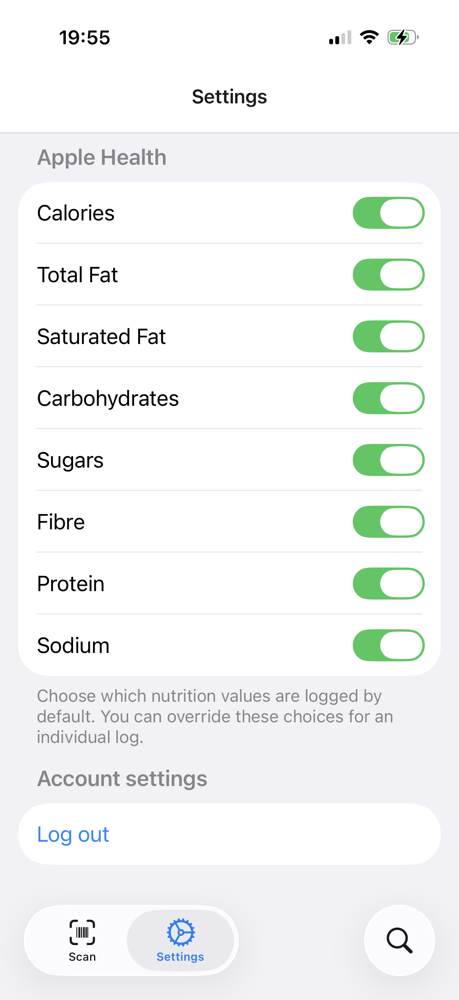

# LabelLog workspace

LabelLog is an iOS app that scans nutrition labels and logs their values to
Apple Health. Scan a product barcode, review the extracted nutrition values,
and save them directly to Apple Health. Nutrition history stays in the Health
app, so LabelLog focuses on capture and logging instead of duplicating Health's
analytics.

The client has been tested on iOS 16.4 and later. This repository contains the
Expo app, its API server, and their shared TypeScript API contracts in a pnpm
workspace.

## Screenshots

<p>
  
  
  
</p>
<p>
  
  
  
</p>

## Requirements

- Node.js 22.13 or newer for Expo SDK 57
- pnpm 11.24.0 (run `corepack enable` to use the version declared in the root `package.json`)

## Install

```sh
pnpm install
```

Run the shared checks from the workspace root:

```sh
pnpm lint
pnpm typecheck
pnpm format
```

## Client

```sh
pnpm --filter label-log-client start
pnpm --filter label-log-client ios
pnpm --filter label-log-client android
```

## Server

```sh
pnpm --filter label-log-server build
pnpm --filter label-log-server start
```

For the Docker and PostgreSQL setup, see [apps/server/README.md](apps/server/README.md).

## Workspace packages

- `apps/client`: Expo application
- `apps/server`: Fastify API and database migrations
- `packages/contracts`: TypeScript API contracts shared by client and server

The server provides passwordless email authentication and nutrition extraction
through Mistral. The client sends OCR results to the server and writes approved
nutrition values to Apple Health.
